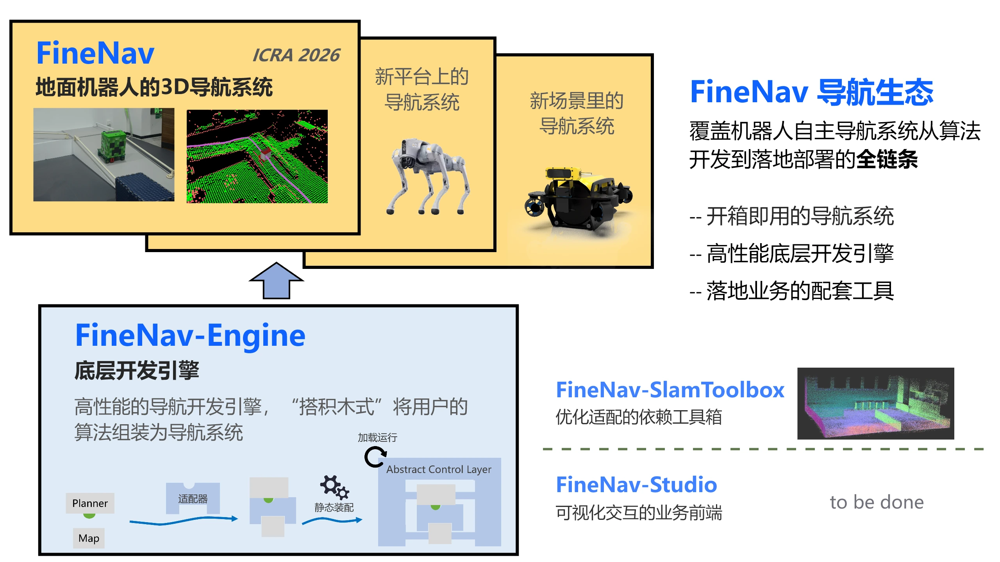

# Overview

FineNav provides tools and components for building robot navigation applications.
Choose your Map and Planner, connect them through a WorldView, and assemble your navigation workflow.

<video class="finenav-demo" controls playsinline preload="metadata" poster="assets/videos/demo1-poster.jpg" width="1920" height="1080" aria-label="FineNav demo1">
  <source src="assets/videos/demo1.mp4" type="video/mp4">
  Your browser does not support embedded video. <a href="assets/videos/demo1.mp4">Download demo1</a>.
</video>

## FineNav-Engine

  <a class="finenav-entry-card" href="finenav-engine/guide/installation/">
    <svg viewBox="0 0 24 24" fill="none" stroke="currentColor" stroke-width="1.7" stroke-linecap="round" stroke-linejoin="round"><path d="m14 5 5 5M4 20l4-1L20 7a2.1 2.1 0 0 0-3-3L5 16l-1 4Z"/><path d="M13 20h7"/></svg>
    Get started
    Build and run your first FineNav example with a step-by-step tutorial.
    Start tutorial →
  </a>
  <a class="finenav-entry-card" href="finenav-engine/guide/why-finenav/">
    <svg viewBox="0 0 24 24" fill="none" stroke="currentColor" stroke-width="1.7" stroke-linecap="round" stroke-linejoin="round"><circle cx="12" cy="12" r="9"/><path d="M12 7v5m0 4h.01"/></svg>
    Why FineNav-Engine?
    Learn how reusable components help you build and adapt your navigation application.
    Learn more →
  </a>

## FineNav-SlamBox

[Documentation placeholder](slambox.md). Repository-specific guides will be added later.

## FineNav (ICRA version)

[Documentation placeholder](icra.md). Repository-specific guides will be added later.
